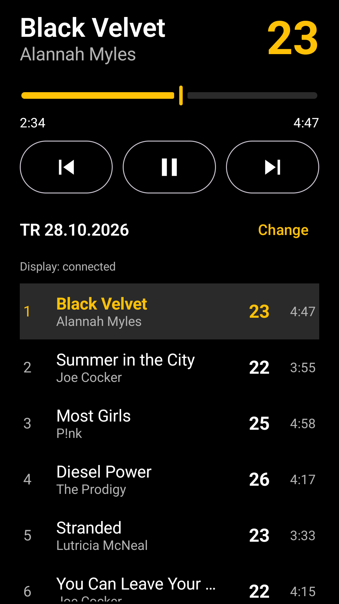

# Teamrowing Remote

An Android phone app for the trainer of a team rowing training session: a remote control for the
Spotify app on the same phone, with big, high-contrast controls.

It's the counterpart of [teamrowing-display](https://github.com/martingregoire/teamrowing-display),
which shows the current and next track with their tempo on a tablet for the participants.



## Features

- **Controls:** the current track, pushed live by the Spotify app, with previous, play/pause and
  next, and a progress bar to seek within the track.
- **Sessions:** each of the trainer's own Spotify playlists can be played as a training session.
  The list shows the sessions (see below) first, newest first, then the other playlists, the
  fundus, by name. The chosen session is remembered, and a playlist started in the Spotify app is
  picked up automatically.
- **Tempo:** each track's tempo (strokes per minute) next to the current track and in the session
  list, as prepared in the display app. Tracks marked "No tempo" show none, unknown ones "–".
- **Tempo correction:** tapping a tempo opens a bottom sheet to type a new value, step it by ±1,
  mark the track as "No tempo", or reset it to the detected value. For a track without a rowing
  tempo yet, it starts with one suggested from the song's BPM (halved until it's a usual rowing
  tempo). Corrections are synced to the display app, right away or at the next connection.
- **Session list:** all tracks of the session with their tempo and duration, the current one
  highlighted and kept second in the list, after the previous one, so the following tracks fill the
  rest; it scrolls back to it 8 seconds after scrolling by hand.
  Tapping a track plays the session from there, in playlist order (shuffle is turned off). Play
  starts the session from the beginning if something else was playing.
- **Sync with the display app:** the tempos come from
  [teamrowing-display](https://github.com/martingregoire/teamrowing-display) on the tablet, over
  Bluetooth while both apps are open. The phone keeps a copy, which it sends back on each connection,
  so it can restore the tablet's data. The connection status is shown below the session name.
- **Instant display updates:** while connected, the phone sends every track change, pause and seek
  to the display app, which shows it right away instead of at its next poll. It also sends
  Spotify's queue, without the autoplay tracks after the session, so the tablet shows the next
  track without internet access.
- The screen stays on while the app is open.

## Preparing sessions

"Prepare" next to the session name checks the session against a few rules, and puts it together
from the fundus. All rules only give hints, nothing is prevented.

- **Sessions** are the trainer's own playlists named `TR` and their date, e.g. `TR 28.10.2026`.
  "New" creates one, named a week after the newest session by default. The sessions before the
  prepared one are its history. Other playlists, such as the fundus, can be prepared too: as they
  have no order, only the tracks themselves are checked, without length, chart and sections.
- **Length:** the rowing time against the target, 45 minutes ± 2 by default. "No tempo" tracks
  are stretching, usually at the end: they don't count, and are shown with their own length.
- **Tempo chart:** the tracks as bars over time, as high as their tempo, on the easy and hard
  tempo bands, with the end of the warm-up, the start of the cool-down and the target length
  marked.
- **Rules,** after the beginner advice of
  [RP3 Rowing](https://rp3rowing.com/blog-items/how-do-you-incorporate-tempo-training-into-rowing-workouts/):
  easy tracks (20–23) in the warm-up (9 min) and cool-down (7 min), no two hard tracks (24 and
  faster) in a row, nothing slower than easy, and steps of at most 4 from one track to the next.
  The numbers can be changed in the settings (gear icon).
- **Tracks:** each with the rules it breaks, a hint if it was in the last session, and the last
  session it was used in. Tracks are moved by pressing and holding them, then dragging; tapping a
  track shows the action to remove it, tapping its tempo edits it. Spotify can only remove all copies of a track, so the app adds the
  other copies of a track that is in the session more than once back.
- **Tempos:** only the trainer's rowing tempos count. Lookups give the song's BPM, usually two or
  four times the rowing tempo, so tracks without a correction show a suggestion in grey (e.g.
  "≈23") until the tempo is set. The phone looks up the BPM of session and fundus tracks itself, and
  syncs them to the display app.
- **Adding tracks:** "Add tracks" lists the tracks of the fundus, the playlists chosen by name
  (all playlists except the sessions), with their tempo and last use. They can be filtered by
  easy, hard or without tempo, hide the tracks of the last session, and be sorted by tempo, by
  the time since they were last used or by length (shortest first). "+" adds a track at the end
  of the session, "▶" opens its tempo and plays it from the middle to listen to it first.
- **Tapping the tempo:** in the tempo editor, tapping along with the beat or the strokes measures
  the tempo, and the rowing tempo it stands for, halved as often as needed, is entered. On the
  preparation screens, the editor can also play the track, with a seek bar; playback started there
  is paused when it closes.

## How it works

- The [Spotify App Remote SDK](https://developer.spotify.com/documentation/android) controls the
  Spotify app on the same phone and pushes its player state, so no polling is needed.
- The [Spotify Web API](https://developer.spotify.com/documentation/web-api) provides the
  playlists, and the queue for the display app, which the SDK doesn't provide, and changes the
  session playlists while preparing them. The app logs in with the Authorization Code flow with
  PKCE, so no client secret is needed.
- The tempos are synced with the display app over Bluetooth (RFCOMM): the remote connects to the
  display app on a paired computer, tablet or phone, starting with the last connected one, and
  retries every 10 seconds. It also sends the SDK's playback state on every change, and the queue
  when the track changes and every 15 seconds. The protocol
  and the BPM entry format (`sync/SyncSession.kt`, `bpm/BpmEntry.kt`) are kept identical in both
  apps; see the display app's README.
- The login also grants the SDK's `app-remote-control` permission. The SDK can't ask for it
  itself on Android 15: the Spotify app tries to open its permission dialog from the background,
  which Android blocks.

## Requirements

- A Spotify Premium account and the Spotify app on the phone.
- An Android phone with Android 8.0 (API 26) or newer.
- The app isn't published: whoever builds it (see [Development setup](#development-setup)) must
  add the trainer's Spotify account to their Spotify app in the Developer Dashboard. In
  Development Mode, up to 5 Spotify users can be added there.
- For the tempos: [teamrowing-display](https://github.com/martingregoire/teamrowing-display) on a
  tablet, and Bluetooth on both devices. Without it, the app still controls Spotify, but shows no
  tempos.

## Setup

- For the tempos: pair the phone with the display tablet once in Android's Bluetooth settings, and
  allow the "Nearby devices" permission when the app asks for it.
- On LineageOS with restricted network access for new apps, allow network access for the app
  once: App info → Mobile data & Wi-Fi → Network access.

## Development setup

- A Spotify app registered in the [Spotify Developer Dashboard](https://developer.spotify.com/dashboard),
  separate from the display app's, with each trainer's Spotify account added as a user:
  - APIs: **Web API** and **Android**
  - Redirect URI: `teamrowing-remote://callback`
  - Android package `de.gregoire.teamrowingremote`, with the SHA-1 fingerprints of the debug key
    and the release key
- [mise](https://mise.jdx.dev) provides the JDK (`mise.toml`) and puts the Android SDK tools on the
  `PATH`. Run `mise install` once in the project directory.
- [Android Studio](https://developer.android.com/studio) installs the Android SDK to `~/Android/Sdk`.
- The Spotify App Remote SDK is only distributed as an AAR on
  [GitHub](https://github.com/spotify/android-sdk/releases) and is included in `app/libs`.
- The Spotify client ID goes into `~/.gradle/gradle.properties`, outside the repository:

  ```properties
  teamrowingRemote.spotifyClientId=<client ID from the Spotify dashboard>
  ```

The Spotify app isn't available on the emulator, so the app is developed against a real phone,
e.g. connected with wireless debugging. Build and install a debug version:

```sh
./gradlew installDebug
```

Get the debug key's SHA-1 fingerprint for the Spotify dashboard with:

```sh
keytool -list -v -keystore ~/.android/debug.keystore -alias androiddebugkey -storepass android | grep SHA1
```

## Release build

Release builds are signed with the same key as the display app, configured in
`~/.gradle/gradle.properties` as described in the display app's README
(`teamrowingDisplay.releaseKeystore`, `teamrowingDisplay.releaseKeystorePassword`,
`teamrowingDisplay.releaseKeyAlias`). Without it, Gradle builds an unsigned APK.

```sh
./gradlew assembleRelease
adb install -r app/build/outputs/apk/release/app-release.apk
```

Build updates from a release tag (see [Releasing](#releasing)), whose version Android accepts as
newer than the installed one.

Debug and release builds are signed with different keys, so switching between them requires
uninstalling the app first, which deletes its login, session choice and BPM copy (the BPM values
come back from the display app at the next connection). On LineageOS, network access then has to
be allowed again.

R8 must not shrink or rename the Spotify App Remote SDK: with only the SDK's own rules, the
release build can't find the Spotify app (`CouldNotFindSpotifyApp`).
`app/src/main/keepRules/rules.keep` keeps the SDK as a whole and tells R8 to ignore the Jackson
and annotation classes it only references optionally.

## Releasing

Releases work as in the display app, described in its README's
[Releasing](https://github.com/martingregoire/teamrowing-display#releasing) section: the changes are
listed in [CHANGELOG.md](CHANGELOG.md), each release is a tag like `v1.2.3` from which Gradle takes
`versionName` and `versionCode`, and the [release workflow](.github/workflows/release.yml)
creates a GitHub release with the version's changelog section as release notes, without an APK.
The changelog notes which version of the display app a version needs.

## License

Licensed under the [Apache License 2.0](LICENSE).

The Spotify App Remote SDK in `app/libs` is by Spotify AB, from
[spotify/android-sdk](https://github.com/spotify/android-sdk), also under the Apache License 2.0
([license](app/libs/spotify-app-remote-LICENSE), [notice](app/libs/spotify-app-remote-NOTICE)).
